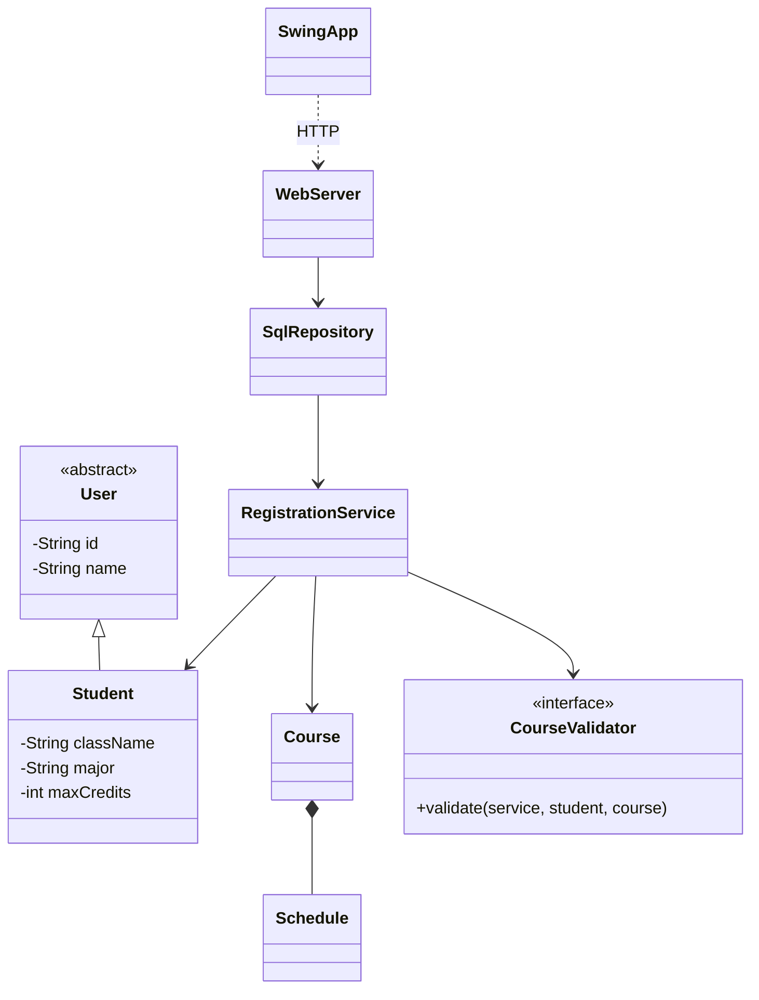

# Thiết kế hệ thống đăng ký môn học

SQLite có ba bảng: `students`, `courses`, `registrations`. Bảng đăng ký có khóa chính ghép mã sinh viên và mã môn. Sĩ số và tổng tín chỉ được tính từ các bản ghi đăng ký. Các trường dữ liệu trong lớp Java được đóng gói. Ba cách kiểm tra sĩ số, tín chỉ và lịch học cùng triển khai interface `CourseValidator`. Hàm `Schedule.overlaps` kiểm tra hai khoảng giờ giao nhau trên cùng một ngày.

Hai giao diện gọi cùng máy chủ Java. Khi đăng ký hoặc hủy, JDBC mở giao dịch SQLite trước bước kiểm tra và hoàn tất giao dịch sau khi cập nhật. `data/setup.sql` được đọc từ file khi khởi động.

| Phần việc | Người phụ trách |
|---|---|
| Lớp dữ liệu, quy tắc đăng ký | Điền tên |
| SQLite, JDBC, máy chủ Java | Điền tên |
| Giao diện Swing và web | Điền tên |
| Kiểm thử, sơ đồ lớp và demo | Điền tên |
